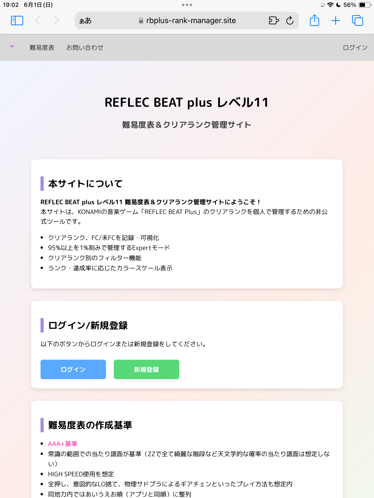
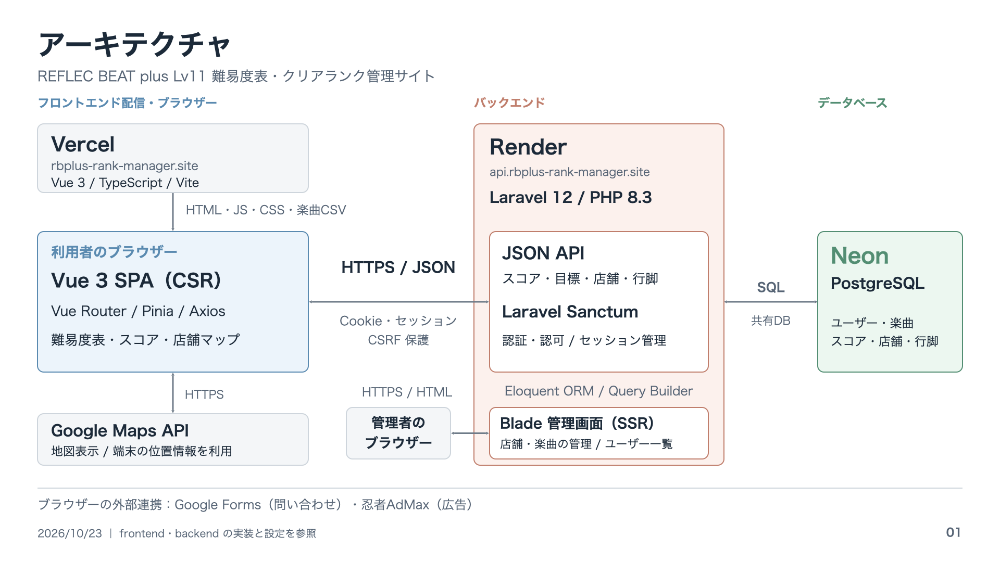
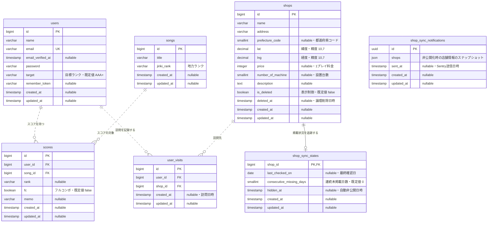
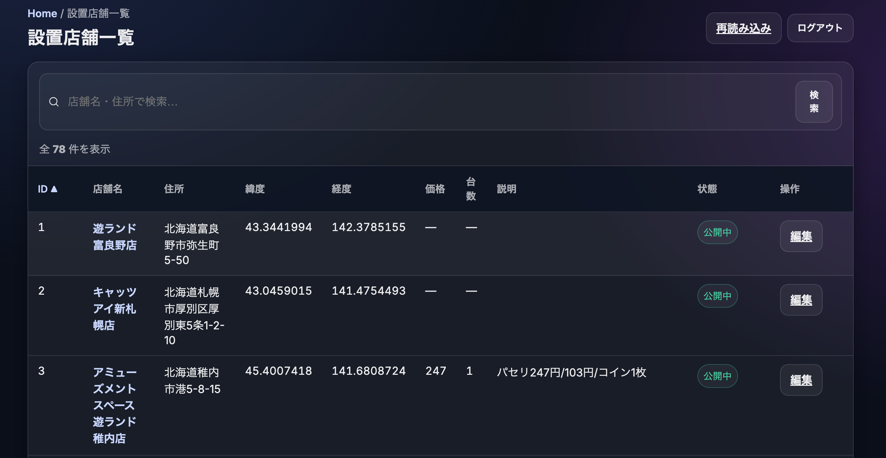
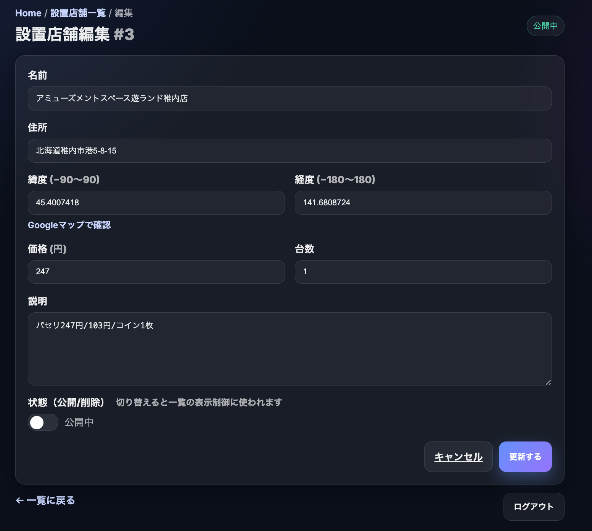

[](https://rbplus-rank-manager.site)

本リポジトリは、「REFLEC BEAT plus Lv11 難易度表＆クリアランク管理サイト」開発プロジェクトの<br>
[フロントエンド](https://github.com/misato729/score-manager-frontend)と[バックエンド](https://github.com/misato729/score-manager-backend) の構成・機能をまとめた説明用の統合リポジトリである。実装とCI/CDは、それぞれのリポジトリで管理している。

# フロントエンド概要

**REFLEC BEAT plus Lv11 難易度表＆クリアランク管理サイト**

- **目的**：音楽ゲーム REFLEC BEAT plus のLv11のクリアランク・フルコンボ状況の管理を行う。
- **機能**：
  - Lv11の譜面を非公式に10段階に定義した「難易度表」を閲覧可能
  - 譜面ごとにクリアランク・フルコンボ状況を保存
  - Google Maps APIで店舗情報閲覧＆チェックイン機能
- **使用技術**：Vue 3 + TypeScript / Laravel 12 / PostgreSQL / Vercel + Render + Neon
- **URL**：[https://rbplus-rank-manager.site](https://rbplus-rank-manager.site)

- **画面イメージ**

### TOP画面



### 難易度表画面


### 設置店舗マップ画面


- **例**（開発者のマイページ）
  - [難易度表](https://rbplus-rank-manager.site/dashboard/10)
  - [行脚履歴](https://rbplus-rank-manager.site/visited_shops/10)

## 背景

音楽ゲームの課題として、公式の同一レベル内でも譜面ごとに難易度差が大きいという点がある。<br>
そこで、音楽ゲームプレイヤーの間では、公式難易度を有志により細分化された非公式の「難易度表」が活用されることが多い。<br>
例えばKONAMIの人気音楽ゲーム「beatmania ⅡDX」は最高レベルは12であるが、Lv12の中でも難易度の差が激しく、有志によってLv12をさらに数段階に分ける試みがなされている。<br>
近年では、難易度表をWebアプリ化してクリアランクを管理する試みがなされている。<br>

※参考：<br>

- [12参考表(地力表)支援サイト](https://sp12.iidx.app)
- [CPI](https://cpi.makecir.com)
<br>
この難易度表の存在により、プレイヤーは実力に見合った適切な難易度の曲を選ぶことができる上、自分のプレイ進捗を可視化できる。<br>
<br>
一方、同じくKONAMIの音楽ゲーム「REFLEC BEAT」は「beatmania ⅡDX」と比べるとマイナーなゲームであり、このようなWebアプリがまだ存在していない。<br>
また、「REFLEC BEAT」も同様に、最高レベルのLv11の中でも難易度差が激しいという課題がある。<br>
そこで私は、「REFLEC BEAT」においても上記のような難易度表のWebアプリを作成し、プレイヤーのモチベーション維持に貢献するため開発に至った。

## URL

https://rbplus-rank-manager.site<br>

# 構成図

## アーキテクチャ構成図

### アプリケーション構成



ユーザー向け画面はVue 3 + ViteのSPAで、VercelからHTML・JavaScript・CSSなどの静的ファイルを配信する。ブラウザー内で動作するVueが、Render上のLaravel API（`https://api.rbplus-rank-manager.site`）へ直接HTTPSで通信する。ゲスト向けの難易度表・楽曲一覧は静的CSVを利用し、ユーザー別のスコア・行脚履歴はAPIで取得する。

SPAの認証はLaravel SanctumによるCookie・セッション認証とCSRF保護を使用する。管理画面は同じLaravelアプリケーションのBlade（SSR）でHTMLを返し、Webセッション認証と許可ユーザーIDによるアクセス制御を行う。API・管理画面ともに、LaravelのコントローラーとEloquent ORM / Query Builderを通じてNeonのPostgreSQLにアクセスする。

店舗マップにはGoogle Maps API、問い合わせにはGoogle Forms、広告には忍者AdMaxを利用する。現在地はブラウザーのGeolocation APIで取得する。

### 店舗情報の自動同期


Google Apps Script（GAS）が毎日07:00（日本時間）を指定してGitHub Actionsへ起動依頼する。通常は本実行と7時台の予備確認の計2回GASが動作し、店舗同期は1日1回行う。GitHubへの起動依頼に失敗した場合だけ7時台に再試行する。自動の起動依頼は07:00以上08:00未満に限り、実際の開始にはGASの遅延やGitHub runnerの待ち時間が加わる。

GitHub ActionsがLaravelの `shops:sync-konami` コマンドを実行する。KONAMI公式の設置店舗検索を全47都道府県分取得し、都道府県・店舗名で照合する。Renderの起動状態に依存せず、ActionsからNeonへ直接接続する。

- すべての取得が正常に完了した後、掲載状況を更新する。取得失敗時は更新しない。
- 起動依頼の受付後に同期処理が失敗した場合は、自動で再実行せず原因確認後に手動実行する。
- 5日連続で未掲載の既存店舗を非公開にする。自動非公開にした店舗が公式検索に復帰した場合は再公開する。
- 不在日数は日本時間の暦日単位で数え、同日の再実行では加算しない。取得失敗・未実行で確認が途切れた場合は、次の正常な未掲載確認を1日目とする。
- 手動で非公開にした店舗や削除済み店舗は自動再公開しない。新規店舗の登録や住所・価格・台数の自動更新は行わず、店舗データ・行脚履歴を削除しない。
- 新たな非公開化の通知をDBに保存し、Sentryへ送る。SentryのIssue Alertを設定することでメール通知でき、未送信の通知は次回実行時に再送を試みる。

手動のdry-runや通知テスト、接続・通知設定の手順は[バックエンドの運用説明](https://github.com/misato729/score-manager-backend#設置店舗の自動非公開化再公開)を参照。

## データベース構成（ER図）

本アプリの主要7テーブル（ユーザー・楽曲・スコア・設置店舗・訪問履歴・店舗同期状態・通知履歴）を、[バックエンドのマイグレーション](https://github.com/misato729/score-manager-backend/tree/main/database/migrations)に基づいて示す。型は本番のPostgreSQLに合わせ、認証トークン・セッション・キャッシュ・ジョブなどのLaravel用テーブルは省略している。



PKは主キー、FKは外部キー、UKは一意キーを表す。ユーザー・楽曲・店舗からスコア・訪問履歴への関連は1対0件以上、店舗と同期状態の関連は1対0または1件である。外部キーには親レコード削除時の連鎖削除が設定されている。通知履歴の `shops` は送信対象のJSONスナップショットであり、店舗テーブルへの外部キーは持たない。

# 機能一覧

本アプリの機能は、メインの「難易度表閲覧・クリアランク管理」機能と、サブ要素として開発した「設置店舗閲覧・行脚」機能の2つに分かれる。

## 難易度表閲覧・スコア管理

### 非ログインユーザー向け

- 「REFLEC BEAT plus」収録のレベル11の全譜面について、地力ごとに分類したものを表示する（地力は非公式の10段階：地力F〜地力S+）
- `/dashboard/{userId}` で他ユーザーのスコアを閲覧できる。表示モードやフィルターも利用できる

### ログインユーザー向け

- 各ユーザーは曲に対してランク（AAA+/AAA/...）、フルコンボの可否、メモを保存することができる
- 曲に対してランクをプルダウンで選択すると、曲のカードがランクに対応する色に変化する
- FC（フルコンボ）をチェックボックスで選択すると、曲のカードがFULL COMBO!!と表示される
- 超上級者向けの機能として、AAA+(95%)以上のランクを1%刻みで管理できる「Expertモード」を選択できる
- 99.0%以上を0.1%刻みで管理できる「Proモード」を選択できる（99.0%未満はまとめて表示）
- 表示モードはURLクエリ `mode=Normal` / `mode=Expert` / `mode=Pro` で保持し、再読込・共有でも維持される（未指定・不正値はNormal）。モード切替では保存済みのランクを変更しない
- Expert・Proモードで「100%」のランクを選択すると、曲のカードがEXCELLENT!!!と表示され、FCも自動的にONになる
- フィルター機能があり、ランクとフルコンボ/未フルコンボで絞り込みができる
- 各ユーザーは目標ランクを設定することができ、目標に対する進捗状況をプログレスバーで視覚的に確認できる
- 「全体」プログレスバーは目標ランクの達成曲数／全曲数から達成率を計算し、対応ランクの色で表示される
- 「FC」プログレスバーはフルコンボ数／全曲数から達成率を計算し、ピンク色で表示される
- スコア・メモ・目標の保存操作はログイン本人のページで利用できる

## 設置店舗閲覧・行脚

### 非ログインユーザー向け

- アーケード版「REFLEC BEAT」の設置店舗を地図上で確認できる
- Google Maps上にピンが立っており、クリックすると店舗詳細を確認できる
- 詳細情報では1クレ料金、台数、メンテ状況、他音ゲー情報を確認できる
- `/visited_shops/{userId}` で他ユーザーの行脚履歴を閲覧できる

### ログインユーザー向け

- ユーザーは、訪問した店舗を位置情報によるチェックインで記録することができる（これを「行脚」という）
- 店舗一覧画面では、ログイン済み・未訪問で、現在地と店舗の距離が500m未満の場合に「チェックインする」ボタンが表示される
- 訪れたことのある店舗を「行脚履歴」画面で確認することができる（表示項目は「都道府県」「店舗名」「訪問日時」）

## その他機能

- ユーザーは、アカウントの新規登録・ログイン・ログアウト・削除をすることができる
- お問い合わせフォームまたはGmail、公式Xから開発者への連絡や設置店舗の情報提供ができる

# 使用技術

| 分類          | 使用技術・サービス                                      |
|---------------|---------------------------------------------------------|
| フロントエンド | Vue 3, Vite, TypeScript, Pinia, Vue Router, Axios     |
| バックエンド   | PHP 8.3, Laravel 12, Laravel Breeze, Laravel Sanctum, Laravel Blade     |
| インフラ       | Vercel（フロントエンド配信）, Render（Laravel）, Neon（DB） |
| データベース   | PostgreSQL（本番 / Neon）, SQLite（ローカル・テスト）, PostgreSQL（CIの一部テスト） |
| 定期実行・通知 | Google Apps Script（予約・起動依頼）, GitHub Actions（店舗同期）, Sentry（イベント・Issue Alert通知） |
| デザイン       | Figma（画面設計）|
| その他         | Google Maps API, Google Forms, 忍者AdMax, GitHub, ChatGPT, Codex |

## フロントエンドのCI/CD

[フロントエンドのGitHub Actions](https://github.com/misato729/score-manager-frontend/tree/main/.github/workflows)とVercelで実行する。

- **Unit Test**: Vitestでカバレッジ付きのテストを実行
- **Preview Deploy / E2E**: 非DraftのPRをVercel Previewへ配信し、Playwrightで確認。Preview保護の回避設定を使用する
- **Production Deploy / Smoke Test**: `main` へのpushでVercel本番へ配信し、本番のスモークテストを実行。定時・手動のスモークテストも用意している

Lint / Typecheckのステップは `--if-present` で定義しているが、現在の `package.json` には対応するスクリプトを定義していない。

# バックエンド概要

用途は以下の3つである。

① フロントのAPIリクエスト（スコアの取得・更新、設置店舗の取得など）に返答する。

② Laravel Blade（SSR）の管理システムで設置店舗・楽曲を管理し、ユーザー一覧を確認する。

③ GitHub Actionsから店舗情報の同期コマンドを実行し、掲載状況と通知履歴を管理する。

当初は①のみでリリースしていたが、管理システムでデータを管理できた方がサービス運用が楽になると思い、②の開発にも至った。

# 機能一覧

## ① APIレスポンス

本APIは、フロントエンドとのデータ送受信に利用する。
以下のAPIは成功時にJSON形式でレスポンスを返す。バリデーション・認証エラーもJSONで受け取るため、クライアントは `Accept: application/json` を送信する。Bladeの管理画面はHTMLを返す。

SPAの認証はLaravel SanctumのCookie・セッション方式であり、ログイン前に `GET /sanctum/csrf-cookie` でCSRF Cookieを取得する。AxiosはCookieを送信し、CSRFトークンをヘッダーに設定する。認証保護されたAPIには `auth:sanctum` を適用し、スコア更新・アカウント削除などでは本人確認も行う。

### ユーザー関連

| メソッド | エンドポイント | 認証 | 概要 |
| --- | --- | --- | --- |
| POST | `/api/login` | 不要 | メールアドレス・パスワードでログインし、セッションを再生成 |
| POST | `/api/register-user` | 不要 | 新規ユーザー登録（スコア初期化含む） |
| GET | `/api/user` | 必要 | ログイン中ユーザーの情報を取得 |
| POST | `/api/logout` | 不要 | セッションを破棄し、CSRFトークンを再生成 |
| DELETE | `/api/users/{id}` | 必要 | 本人のアカウントを削除（保護された検証用アカウントを除く） |
| PUT | `/api/users/target` | 必要 | 本人の目標ランクを更新 |

表の「認証」はログイン認証ミドルウェアの要否を示す。`/api/login`・`/api/logout` はWebセッションのルートで処理し、POST時のCSRF保護が適用される。

### スコア関連

| メソッド | エンドポイント | 認証 | 概要 |
| --- | --- | --- | --- |
| GET | `/api/users/{userId}/scores` | 不要 | 指定ユーザーの保存済みスコア一覧を取得 |
| GET | `/api/users/{userId}/song-scores` | 不要 | 指定ユーザーの全楽曲とスコアを取得 |
| POST | `/api/scores` | 必要 | 本人のスコアを登録 |
| PUT | `/api/scores/{score}` | 必要 | 本人のスコアを更新 |

### 店舗関連

| メソッド | エンドポイント | 認証 | 概要 |
| --- | --- | --- | --- |
| GET | `/api/shops` | 不要 | 公開中・未削除の店舗一覧を取得 |
| POST | `/api/visit` | 必要 | 本人の行脚店舗を登録 |
| GET | `/api/visited` | 必要 | 自分の行脚店舗履歴を取得 |
| GET | `/api/users/{userId}/visited-shops` | 不要 | 指定ユーザーの行脚履歴を取得 |

### ヘルスチェック

- `GET /api/health`：認証不要で `{"ok": true}` を返す

## ② 管理システム

本管理システムは **Laravel Blade（SSR）** を用いた管理画面である。Laravelの管理用コントローラーがモデルを通じて共有DBにアクセスし、ブラウザーにはHTMLを返す。

### 機能概要

- **店舗一覧表示**  
  - 店舗情報を都道府県コード・ID順で表示
  - 店舗名や住所の部分一致検索機能
  - 公開中／非公開の状態表示


- **店舗登録・編集**
  - 店舗名、都道府県コード、住所、緯度経度、価格、台数、説明文、公開・非公開の状態を登録・更新可能
  - バリデーションチェック付き（必須項目・文字数・数値型）


- **公開・非公開の切替**
  - `is_deleted` フラグをON/OFFすることで、実データを残したまま表示制御
- **楽曲一覧・編集**（`/admin/songs`）
  - タイトル・地力ランクで検索し、タイトルと地力ランクを編集できる
- **ユーザー一覧**（`/admin/users`）
  - ID・ユーザー名・メールアドレス・登録日時を50件ずつ表示し、ユーザー名・メールアドレスで検索できる
  - ユーザー情報の編集・削除は行わない
- **UIデザイン**  
  - CSSとシンプルなBlade構文によるレスポンシブ対応デザイン 
  - 成功／エラー時のトースト通知表示

### アクセス制御

- LaravelのWebセッション認証
- ミドルウェアによって、環境変数 `ALLOWED_USER_ID` に設定されたユーザーID（自分）のみアクセス可能
- 未認証時はログイン画面へリダイレクト
- 認証済みでも許可されたID以外はHTTP 403を返却

### 技術ポイント

- Bladeディレクティブ（`@if`, `@foreach`, `@csrf`, `@method` など）を活用
- ルーティングは `routes/web.php` に定義し、`AdminShopController`・`AdminSongController`・`AdminUserController` で処理
- 業務APIは `api.php`、セッション用のログイン・ログアウトAPIと管理画面は `web.php` に定義
- 本番ではLaravelの生成URLをHTTPSに統一（`AppServiceProvider`）

### 関連記事

- [Laravel Bladeで管理画面を作ってみた【MVC】](https://qiita.com/misato729/items/138a89c3ad8b3e2f0716)  
  → 管理画面（店舗CRUD）を作る過程を整理した学習アウトプット記事です。

## バックエンドのCI/CD

[バックエンドのGitHub Actions](https://github.com/misato729/score-manager-backend/tree/main/.github/workflows)でテスト・店舗同期を実行し、Renderと `main` を連携している。

- **Feature Test**: `main` のpush・PRでPHPUnitを実行。SQLiteのテストに加えて、店舗API・同期・通知・店舗管理・ユーザー一覧はPostgreSQLでも検証する
- **Production Deploy**: `main` の更新をRenderへ自動デプロイ。DockerでLaravelを起動し、起動時にマイグレーションを適用する
- **Shop Sync**: 毎日の定期実行に加え、変更候補だけを確認するdry-runと通知テストを手動実行できる

## 設置店舗の自動非公開化・再公開

[KONAMI公式の設置店舗検索](https://p.eagate.573.jp/game/facility/search/p/index.html?gkey=REFLECC)を取得し、公開中の店舗が検索結果から5日連続で消えていた場合に `is_deleted` を `true` にする。自動非公開化した店舗が公式検索に復帰した場合は、自動で再公開する。
都道府県と店舗名で照合し、店舗名の全角英数字・空白の表記差を吸収する。

- 全47都道府県の検索結果を正常に取得できてから更新する。設置店舗が0件の県も正常な結果として扱う。
- 不在日数は日本時間の暦日ごとに記録する。同日の再実行で日数を増やさず、公式検索への復帰でリセットする。5日目の正常な確認で非公開化する。
- 取得失敗や実行されなかった日を挟む場合は、5日連続の不在を確認できないため、次に正常取得できた不在日を1日目として数え直す。
- 通信失敗や取得形式の変化を検出した場合は更新せず、エラー終了する。
- 再公開するのは、同期処理が自動非公開にした記録（`shop_sync_states.hidden_at`）がある既存店舗だけとする。手動で非公開にした店舗や削除済み（`deleted_at` が設定された）店舗は再公開しない。
- 管理画面で非公開の状態を保存した場合、公開状態を変更した場合、または店舗名・都道府県・住所を変更した場合は、不在日数と自動非公開の追跡をリセットする。公開中の店舗の価格・台数などだけを編集した場合は追跡を継続する。
- 新規登録や住所・価格・台数の更新は行わない。
- 店舗データや行脚履歴は削除しない。
- この仕様の導入前の不在日数は推測せず、導入後の正常な確認日から数える。

実行環境のデータベース設定を使い、次のコマンドで確認・更新できる。

```bash
# 変更候補の確認のみ（DB更新なし）
php artisan shops:sync-konami --dry-run

# 不在日数の記録・非公開化・再公開を実行
php artisan shops:sync-konami
```

### 毎日の自動実行

Google Apps Script（GAS）が日本時間の07:00を指定して当日分を1回だけ、GitHub Actionsの `Sync KONAMI shops` へ実行依頼する。全日の毎分起動は行わず、通常は07:00の単発予約と、予約の欠落に備えた7時台の予備確認の2回だけ実行する。起動依頼の失敗時に限り7時台だけ再試行する。KONAMIのメンテナンス時間05:00〜07:00を含め、7時台以外は自動同期を起動しない。実際の開始にはGASの起動遅延やGitHub runnerの待ち時間が加わる。
RenderのWebサービスの起動状態に依存せず、GitHub Actionsから直接DBへ接続する。

1. コードとワークフローをデフォルトブランチ（`main`）へ反映する。GASは `main` を指定して起動し、ワークフローもデフォルトブランチ以外の本番DB接続を拒否する。
2. Renderのデプロイ完了とマイグレーション適用を確認し、通知保存用の `shop_sync_notifications` テーブルと掲載状況の追跡用の `shop_sync_states` テーブルを作成する。別の方法で配置する場合は、対象環境で `php artisan migrate --force` を実行する。通常の同期を実行する前に両テーブルの存在を確認する。
3. リポジトリの **Settings → Secrets and variables → Actions** に `SHOP_SYNC_DATABASE_URL` を登録する。値にはGitHub Actionsから接続可能なPostgreSQLの外部接続URLを使用する。Render内部向けURLは使用できない。店舗情報・掲載状況・通知記録の読み取り・更新に必要な権限を持つDBアカウントを使用する。
4. **Actions → Sync KONAMI shops → Run workflow** で `main` を選び、まず `dry_run` をオンにして変更候補を確認する。オフにすると更新する。GASからの通常起動時は更新する。

接続URLはGitHub Secretsで管理し、ログに出力しない。このワークフローはマイグレーションやシードを実行しない。

#### GASからの定期起動

GitHub Actionsの予約イベントが遅延・欠落したため、追加費用なしでGoogle Apps Script（GAS）から既存のワークフローを起動する。[設定手順とコード](automation/shop-sync/README.md)を参照する。DB接続情報とSentry DSNは引き続きGitHub Secretsに保持する。

GitHub側の `schedule` は削除し、起動元をGASに一本化する。`workflow_dispatch` はGASと手動確認の両方で使用する。GAS経由の実行には実行名に予定日と `GAS` が表示される。

Neonのpooler接続をPHP 8.3で使用するため、PostgreSQL接続に `PDO::PGSQL_ATTR_DISABLE_PREPARES => true` を設定している。RenderとGitHub Actionsの両方に適用し、[PHPのPostgreSQLドライバー](https://www.php.net/manual/en/class.pdo-pgsql.php#pdo-pgsql.constants.attr-disable-prepares)からクエリと値を分けて送ることで、booleanを含む型推論を維持しながらPgBouncerと非互換の名前付きprepared statementを避ける。

### 非公開化時のメール通知（Sentry）

公式検索で5日連続の未掲載を確認し、新たに非公開化した店舗がある場合、店舗名・都道府県・住所・管理画面の編集リンクと実行元をSentryへ通知し、SentryのIssue Alertからメールを送る。不在の1〜4日目や、掲載復帰による自動再公開時は新しい通知を作成しない。
公式検索から消えた理由は撤去だけでなく一時的な未掲載や店舗名の変更の場合もあるため、通知内容を確認する。自動非公開化した店舗が同じ都道府県・店舗名で公式検索に復帰すれば自動で再公開する。店名変更なら管理画面で公式検索と一致する店舗名へ修正し、非公開チェックを外して再公開する。

1. Sentryの対象プロジェクトのDSNを、GitHub ActionsのSecret `SHOP_SYNC_SENTRY_DSN` に登録する。ローカルなどから実行する場合は同名の環境変数に設定する。
2. Sentryで[Issue Alert](https://docs.sentry.io/product/alerts/create-alerts/issue-alert-config/)を作成する。環境を `production`、イベントのタグ条件を `event_type` が `shops_hidden`、発火条件を新規Issueの発生に設定する。非公開化の通知単位ごとにUUIDを含む[fingerprint](https://docs.sentry.io/platforms/php/usage/sdk-fingerprinting/)を使い、別の通知を新規Issueとして扱う。
3. 通知先には希望するメールアドレスを認証済みのプライマリメールにしているSentryメンバーを選ぶ。対象プロジェクト・チームへの参加と、本人のメール通知設定を確認する。アプリ側のSMTP設定や送信元メールアドレスの設定は不要。
4. 管理画面のURLを変更する場合は、GitHub ActionsのVariable `SHOP_SYNC_ADMIN_URL` を設定する。未設定時は `https://score-manager-backend.onrender.com` を使う。GitHub Actions外では同名環境変数を使い、省略時は `APP_URL` を使う。
5. **Actions → Sync KONAMI shops → Run workflow** で `test_notification` をオンにして実行する。明確なテスト表示のイベントだけを送信し、店舗の状態や通知履歴は変更しない。Sentryのイベントと受信メールを確認する。通常実行時はオフに戻す。環境変数を設定した環境では `php artisan shops:test-sync-notification` でも確認できる。

`--dry-run` では通知しない。新たな非公開化がなければ新しい通知は作成しないが、未送信の通知が残っていれば再送を試みる。
DSN未設定や送信失敗の場合も店舗の非公開化は継続し、通知内容をDBに保存する。設定・通信が回復した後の通常実行で未送信分を再送する。
導入前の未送信通知に5日連続の確認記録がない場合は、従来どおりの非公開化通知として送り、不在日数や自動再公開を推測して案内しない。
Sentryへの送信成功とメールの到着は別の確認となるため、運用開始時にはSentry上のイベント、Alert設定、受信メールまで確認する。

# 今後の展望

店舗・楽曲の管理とユーザー一覧は実装済みである。今後は、運用上必要なユーザー管理機能の追加を検討していきたい。

## 各リポジトリリンク

- [フロントエンド](https://github.com/misato729/score-manager-frontend)  
- [バックエンド](https://github.com/misato729/score-manager-backend)  

